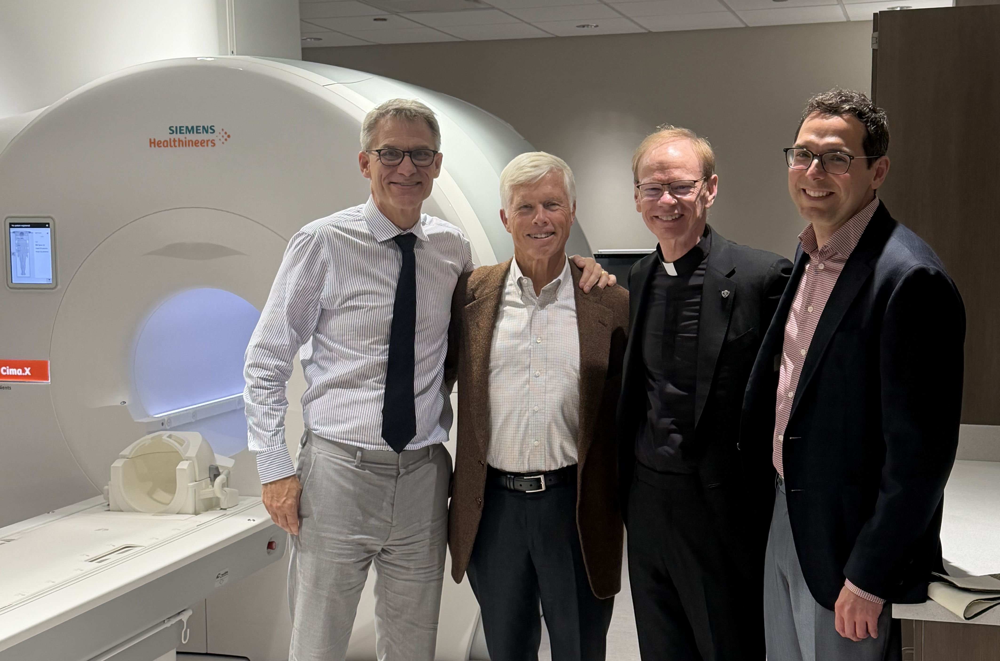
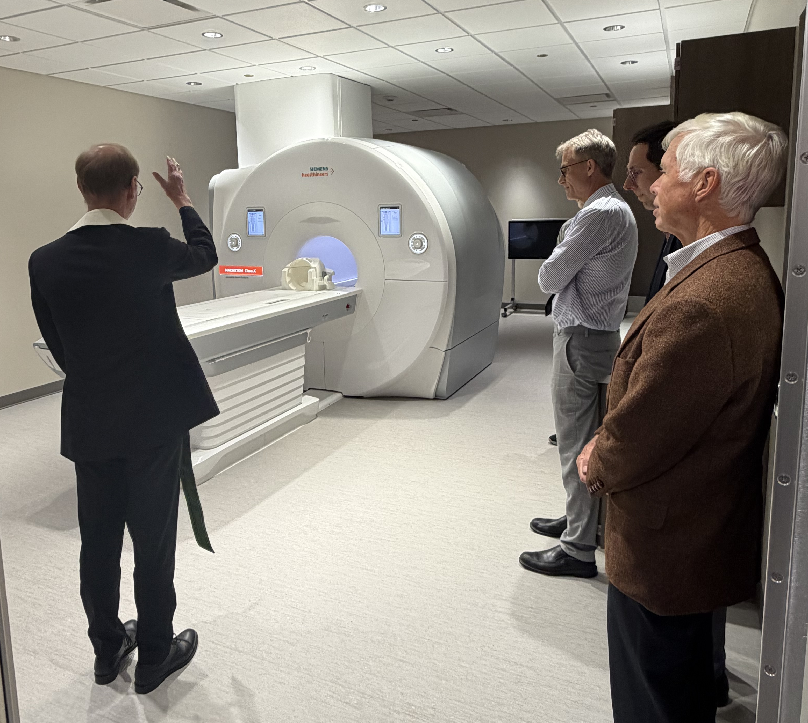
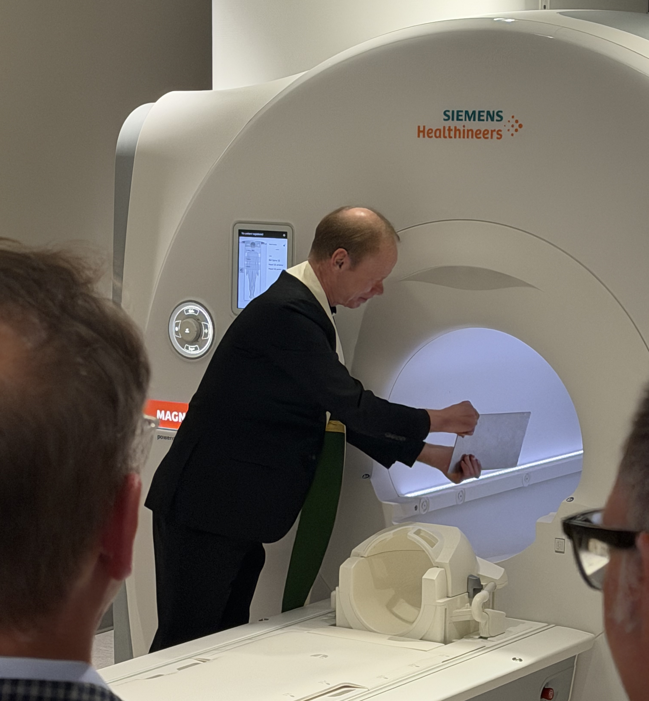

# Special Visit and Blessing

{width=50% fig-align="left"}

**University President Blessed New State-of-the-Art MRI at Human Neuroimaging Center**

_2026-10-16_

University President Rev. Robert A. Dowd, C.S.C., recently visited Notre Dame’s Human Neuroimaging Center to bless its flagship instrument: a new Siemens Cima.X 3 Tesla MRI system.

{width=50% fig-align="left"}

In keeping with Notre Dame’s Catholic mission to place research in service of the common good, Fr. Dowd blessed the high-field scanner, dedicating the technology to truth, healing, and human flourishing. He then personally experienced the strength of the 3 Tesla magnetic field.

{width=50% fig-align="left"}

The Siemens Cima.X 3T MRI scanner represents a major leap forward for neuroimaging at Notre Dame. Equipped with advanced gradient performance and cutting-edge imaging technology, the system enables researchers across disciplines to capture high-resolution images of brain structure and function with unprecedented clarity.

The installation of the Cima.X scanner marks an exciting milestone for the Human Neuroimaging Center, bolstering Notre Dame’s position at the forefront of brain research and human health discovery.
