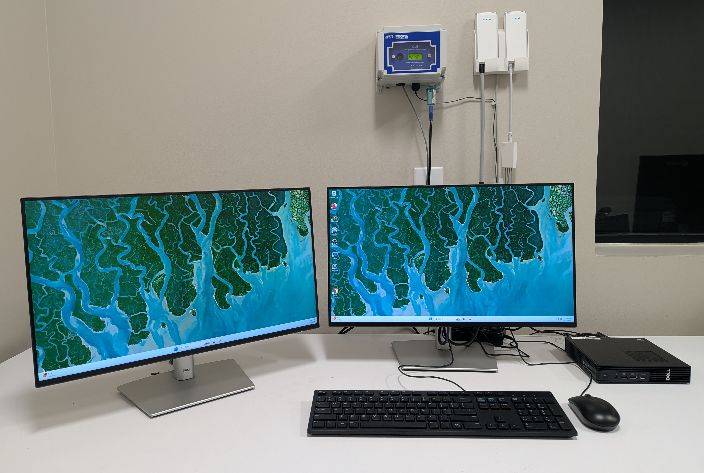
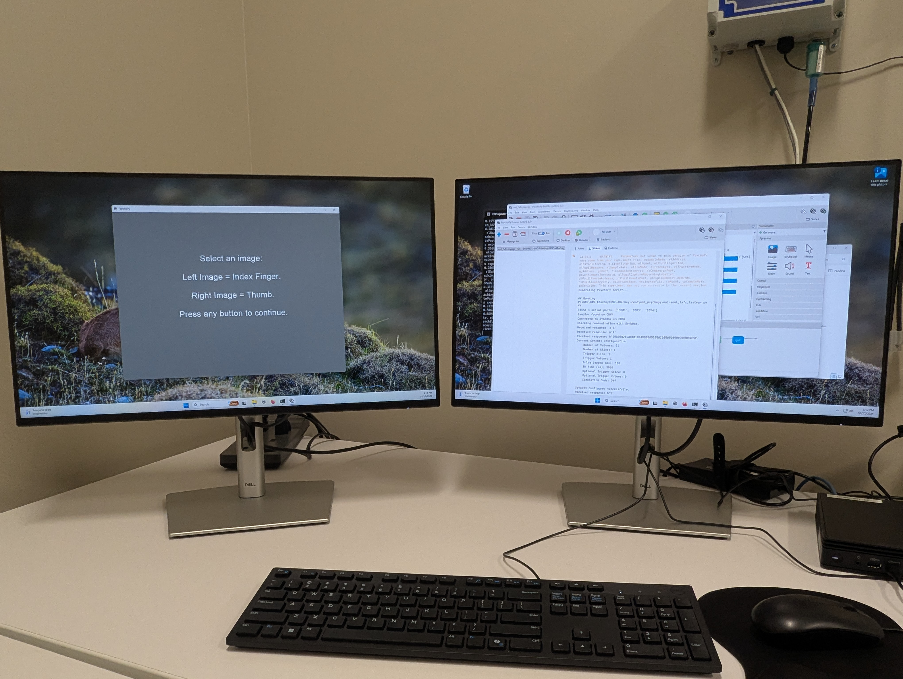
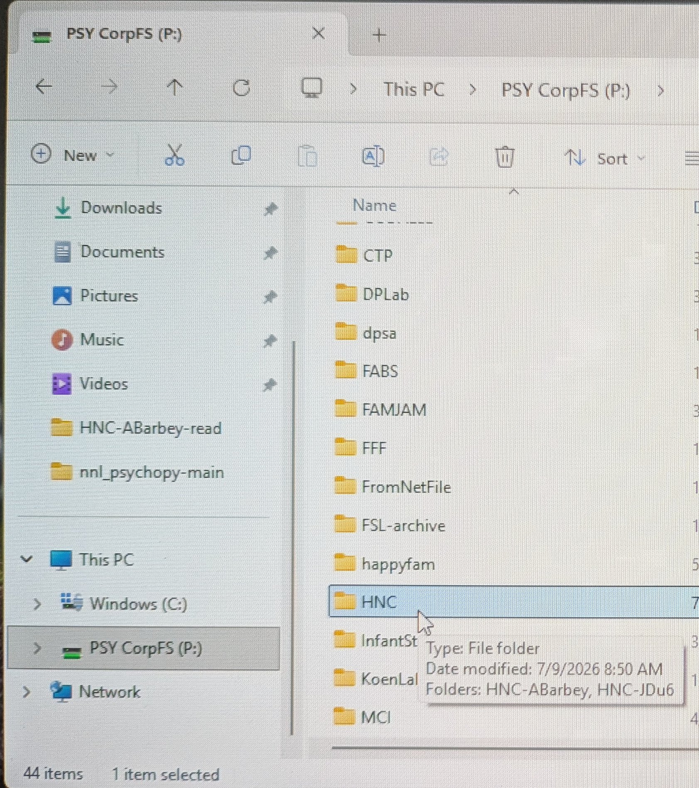
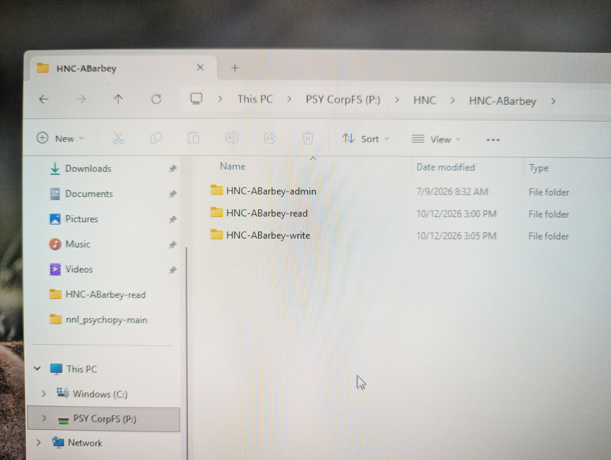
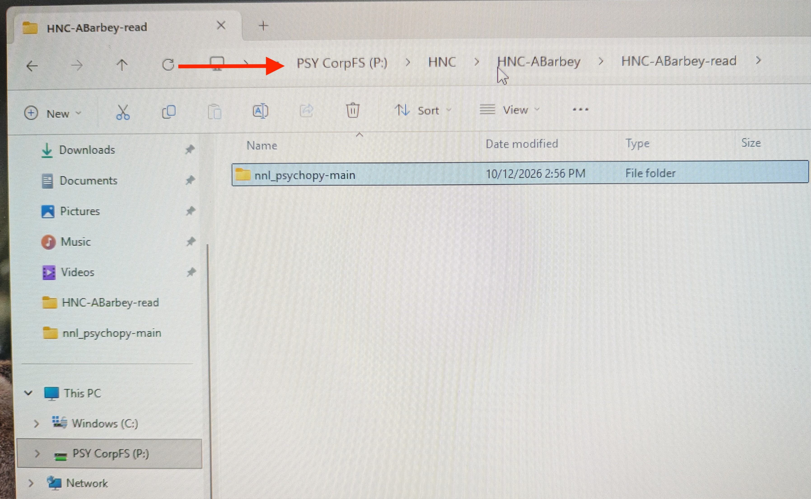
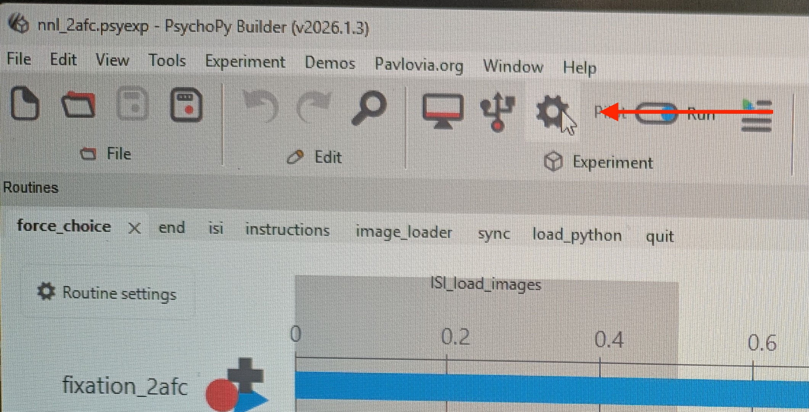
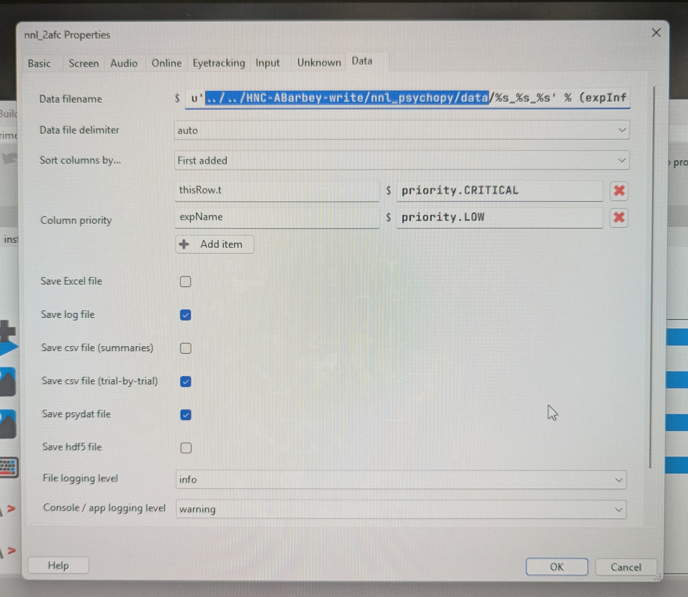
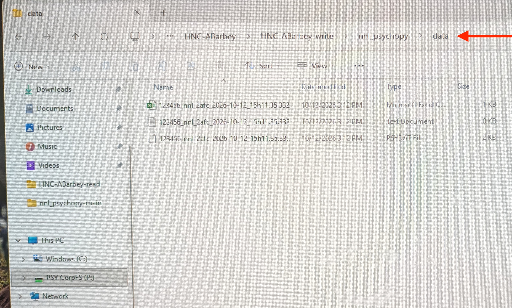

# Overview

Experimental tasks can be deployed by a research team using either a lab-specific computer or the center's Stimulus Control computer. If using the center's machine, extra steps are required to ensure participant anonymity and data security.

# Lab Machine

1. Connect to the Video Converter via HDMI ([Cable C](nnl_syncbox.qmd#sec:video_conv)) to send video.
1. Connect to the NNL SyncBox ([Cable A](nnl_syncbox.qmd#ssec:nnl_syncbox_left)) via USB to:
    * Capture MRI sync pulse
    * Receive participant responses
    * Control SyncBox
1. Deploy your experiment.

# ND-HNC Machine

Experiments deployed from the ND-HNC Stimulus Control computer should be organized within [CorpFS](corpfs.qmd). This will help ensure:

1. Data are organized and stored with proper permissions, and
1. The Stimulus Control computer storage capacity remains in an operational range.

{width=70% fig-align="center"}

## Connect In/Out

* Ensure that the Stimulus Control computer is connected to:
    * Video Converter via HDMI ([Cable C](nnl_syncbox.qmd#sec:video_conv))
    * NNL SyncBox via USB ([Cable A](nnl_syncbox.qmd#ssec:nnl_syncbox_left))

* The **left** screen will be broadcast to the stimulus presentation monitor in Zone 4.

{width=70% fig-align="center"}

## Orient to CorpFS

* Login to the Stimulus Control computer with your ND credentials.
* Navigate to CorpFS -> HNC -> Your Lab.

{width=50% fig-align="center"}

{width=70% fig-align="center"}

* The experiment paradigm should stored in the "HNC-PI-read" location. This helps to:
    * Ensure all team members deploy the same paradigm,
    * Guard against inadvertent alterations.

{width=70% fig-align="center"}

## Configure Output Location

* Specify the output location is "HNC-PI-write".
* For PsychoPy:
    1. Orient to experiment settings
    1. On the Data tab, specify the correct output location.

{width=70% fig-align="center"}

{width=70% fig-align="center"}

## Run Experiment

* Deploy the task.
* Verify output files are written to the proper location.

{width=70% fig-align="center"}